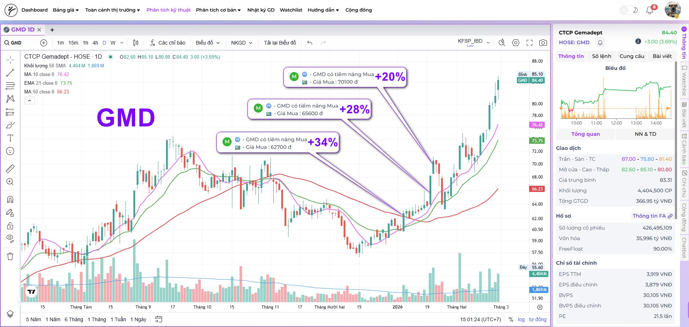

# KFSP Email Assets

Static assets for KFSP email marketing campaigns.

## Usage

```html


```

## Structure

```
logo/       — Logo KFSP
signals/    — BOT signal screenshots (Facebook posts)
icons/      — Shared icons (future)
bao-gia-nang-cap/         — Quote email for upgrade requests: logo-mail.png (header), qr-chung.jpg (account QR, no amount), qr-goi-3m|6m|1y|2y|5y.jpg (QR with the package amount, from HDSD .gitbook/assets/qr-pro-*.jpg, amounts checked by decoding)
tai-app-kungfustockspro/  — Download-app block, name KungFuStocksPro: top, ios (App Store link), android (Google Play link), phone, bottom .jpg, 1200px layout cut at y=256/340 and x=290/560
```
